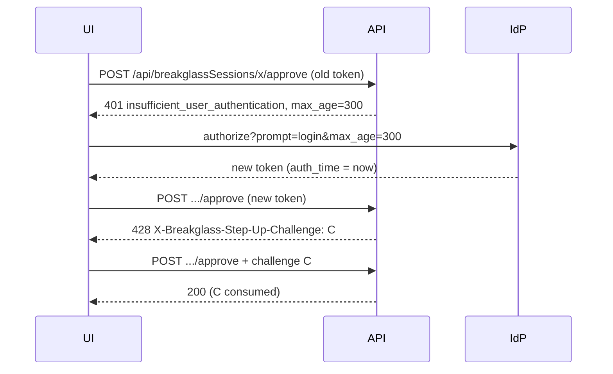

# Design: Step-up Authentication for Critical Mutations

> **Requirement:** PSA PSM-14.47 (fresh, action-bound authentication for critical changes)
> **Status:** Proposal. Draft implementation behind `stepUp.enabled` (default off). Platform IAM must confirm the action list and the mechanism.

## 1. Threat

The Breakglass API accepts OIDC bearer tokens (`pkg/api/auth.go`). A token, or a refresh token
that mints new ones, can be stolen from a browser, a proxy log or a developer laptop. IdP sessions
for the UI often last hours. With such a token an attacker can do the most sensitive things the
API offers: approve a privilege escalation, request a session on an auto-approved escalation, or
open a debug session on a production node. Token expiry alone does not help, because a refresh
yields a new token with the same, old authentication event.

PSM-14.47 asks that critical changes are only accepted after a *fresh* user authentication that is
bound to the *specific* action, so that:

1. a long-lived or stolen session cannot perform the change without the user authenticating again, and
2. a captured request cannot be replayed to repeat the change.

Out of scope: theft of a token minted seconds after re-authentication (mitigated by short
`maxAuthAge`, sender-constrained tokens are a separate topic, see section 8), and changes that do not go
through the Breakglass API (see section 2.2).

## 2. Critical mutations

### 2.1 What the API exposes

The REST API under `/api` only mutates sessions. Escalations, DenyPolicies, ClusterConfigs,
IdentityProviders and DebugSessionTemplates are CRDs and are changed with `kubectl`/GitOps, not
through this API.

| Action name | Route | Effect |
| --- | --- | --- |
| `session.request` | `POST /api/breakglassSessions` | Requests an escalation; grants access at once when the escalation auto-approves |
| `session.approve` | `POST /api/breakglassSessions/:name/approve` | Grants another user elevated groups |
| `session.reject` | `POST /api/breakglassSessions/:name/reject` | Denies a request |
| `session.cancel` | `POST /api/breakglassSessions/:name/cancel` | Approver ends another user's running session |
| `session.withdraw`, `session.drop` | `.../withdraw`, `.../drop` | Owner ends their own request or session (not in the catalogue) |
| `debugSession.create` | `POST /api/debugSessions` | Requests debug pods; may auto-approve |
| `debugSession.approve` | `POST /api/debugSessions/:name/approve` | Starts debug pods for another user |
| `debugSession.reject` | `POST /api/debugSessions/:name/reject` | Denies a debug request |
| `debugSession.join` | `POST /api/debugSessions/:name/join` | Joins someone else's debug session |
| `debugSession.renew` | `POST /api/debugSessions/:name/renew` | Extends a debug session |
| `debugSession.terminate` | `POST /api/debugSessions/:name/terminate` | Owner ends their own debug session |
| `debugSession.injectEphemeralContainer`, `debugSession.createPodCopy`, `debugSession.createNodeDebugPod` | `POST /api/debugSessions/:name/...` | Creates (possibly privileged) pods |

The webhook (`/api/breakglass/webhook/authorize/...`) is called by kube-apiserver, not users, and
the artifact upload/collection routes are called by in-cluster components. Neither is in scope.

### 2.2 Proposed list (default when `stepUp.actions` is empty)

To be confirmed by Platform IAM:

- `session.request` — creating an escalation request, because auto-approval makes it a grant.
- `session.approve` — approving escalations.
- `session.cancel` — terminating other users' sessions.
- `debugSession.create`
- `debugSession.approve` — approving debug sessions.

The candidates "creating/approving escalations" map to `session.request`/`session.approve`.
"Changing DenyPolicies or ClusterConfigs through the API" is not possible today. If such endpoints
are added later they must be added to the catalogue. Changes made with `kubectl` are protected by
kube-apiserver authentication and RBAC, not by this mechanism.

Rejecting, withdrawing and dropping reduce privilege and are not proposed. The debug pod
operations (`join`, `renew`, `injectEphemeralContainer`, `createPodCopy`, `createNodeDebugPod`) are
in the catalogue so that IAM can add them (open question Q2).

## 3. Mechanism

### 3.1 Freshness and assurance (RFC 9470)

For a request to a critical route the server checks the verified token claims:

- **`auth_time`** (OIDC Core): the time of the last active user authentication. With
  `stepUp.maxAuthAge` set, `now - auth_time` must be `<= maxAuthAge` (and `auth_time` not more than
  one minute in the future). A token without `auth_time` is rejected.
- **`acr`**: with `stepUp.requiredACR` set, the claim must equal one of the listed values.

On failure the server answers as in RFC 9470 section 3:

```http
HTTP/1.1 401 Unauthorized
WWW-Authenticate: Bearer error="insufficient_user_authentication",
  error_description="authentication is not recent enough", max_age="300", acr_values="gold"
```

`max_age` is sent when `maxAuthAge` is set, `acr_values` when `requiredACR` is set. The JSON body is
the usual error body (`code: UNAUTHORIZED`). Clients must key on the `WWW-Authenticate` error, not
on the status alone, so that a step-up 401 does not log the user out.

### 3.2 Re-authentication (client)

The frontend reacts to `insufficient_user_authentication` by starting an authorization request with
`prompt=login` and `max_age=<max_age>` (and `acr_values=<acr_values>` when present), then retries the
action with the new access token. A frontend implementation is a follow-up (section 7). `bgctl`
can do the same with its browser login.

### 3.3 Action binding (challenge)

A fresh token alone lets every request within `maxAuthAge` pass, including a replayed one. So each
critical request also needs a single-use server challenge:

1. The client sends the request. The token is fresh but the request has no valid
   `X-Breakglass-Step-Up-Challenge` header.
2. The server creates a random challenge (128 bits, `crypto/rand.Text`) bound to
   `(sub, sid, auth_time, action, request path)`, stores it for 2 minutes and answers
   `428 Precondition Required` with the challenge in `X-Breakglass-Step-Up-Challenge`.
3. The client repeats the same request with that header. The server accepts it only if the stored
   challenge for the same binding matches, and deletes it (consume once).

This follows the server-nonce pattern of DPoP (RFC 9449 section 8). Effects:

- A replayed request fails: its challenge is already consumed.
- A challenge cannot be moved to another action or target (the path includes the session name).
- Binding to `sid` and `auth_time` means a new login invalidates old challenges.

The challenge does **not** prove that the person who just logged in meant this action; an attacker
holding a fresh token can fetch a challenge too. The fresh-authentication check carries the
security weight. The stronger variant, putting the challenge into the authorization request
(`nonce` or a `claims` request) so that the IdP-issued token itself names the action, depends on
what the IdP puts into access tokens (Q5).

### 3.4 Flow



## 4. Draft implementation

- `pkg/config/step_up.go`: `StepUp{Enabled, MaxAuthAge, RequiredACR, Actions}` under the
  top-level `stepUp` key (separate struct to keep `pkg/config` merges simple).
- `pkg/api/step_up.go`: action catalogue, validation, middleware, challenge store.
  `Server.RegisterAll` appends the middleware after each controller's own (authentication)
  middleware. It only acts when `METHOD + route pattern` is a configured action; it reads the
  verified claims that the authentication middleware stores as `raw_claims`. Missing claims fail
  closed.
- Invalid configuration (no requirement, bad duration, unknown action, ACR with spaces or quotes)
  fails `RegisterAll`, so the server does not start.
- With `stepUp.enabled: true`, CORS also allows the challenge header and exposes it and
  `WWW-Authenticate`.
- `TestStepUpActionsMatchRoutes` fails if a catalogue route no longer exists.

```yaml
stepUp:
  enabled: true
  maxAuthAge: 5m
  requiredACR: ["gold"]   # optional
  actions: []             # empty = proposed default list
```

### 4.1 Multi-replica limitation

The challenge store is an in-memory map per replica (like the rate limiter). The API runs on every
replica. If the 428 and the retry reach different replicas, the retry gets a new 428. Until this is
solved, run the API with session affinity (for example ingress-nginx cookie affinity) when step-up
is enabled. Options for a shared store (Q7):

1. A short-lived Kubernetes object per challenge (or annotation on the target session), consumed
   with an optimistic-lock delete. Consistent with how session state is kept, costs one write per
   critical action.
2. Stateless HMAC-signed challenges (shared secret) plus a per-replica consumed cache. No
   writes, but a replay across replicas stays possible within the TTL.

The store holds at most 10,000 pending challenges (one per binding); when it is full after
removing expired entries, the server answers 503.

## 5. Identity providers

- **Keycloak:** access tokens carry `auth_time`, `sid` and `acr`. `prompt=login` and `max_age` are
  supported. Step-up flows (Keycloak 17+ "Conditional - Level of Authentication", ACR-to-LoA
  mapping per client) produce custom `acr` values. With SSO cookies, `max_age` forces a new login
  only when the cookie is older than `max_age`; `prompt=login` always forces one.
- **Other IdPs:** `auth_time` in **access** tokens is not guaranteed (some IdPs put it only in the
  ID token or only as an optional claim; this must be checked per IdP). `acr` values are IdP-specific. For such IdPs
  either the IdP must be configured to emit `auth_time` into the access token, or step-up must use
  `requiredACR` only. A per-IdP setting on `IdentityProvider` is a possible extension (Q4).
- **Multi-IdP:** the settings are global today. Every enabled IdP must emit the claims, or users
  of that IdP cannot perform critical actions.
- **`kubernetesIdentity` providers** (`pkg/oidc`): claims come from the same verified JWT, so the
  check applies unchanged.

## 6. Failure modes

| Situation | Result |
| --- | --- |
| Flag off (default) | No change: no checks, no new headers, no new CORS headers |
| IdP omits `auth_time` | Every critical action gets 401 until IdP is fixed (fails closed) |
| Clock skew between IdP and API | Up to `maxAuthAge` is lost; `auth_time` more than 1 min in the future is rejected |
| Replica switch between 428 and retry | Another 428; can loop without affinity (section 4.1) |
| Pod restart | Pending challenges lost; client gets a new 428 |
| Two tabs, same action and target | The newer challenge replaces the older one |
| Store full (abuse) | 503 for new challenges until entries expire (2 min) |
| Route renamed | Unit test fails; at runtime the action would silently not be checked |
| Old frontend, flag on | Critical actions fail with 401/428 that the UI shows as errors; enable only with a frontend that handles them |

## 7. Upgrade path

1. Merge with the flag off (this PR). No behaviour change.
2. IAM confirms the list and the mechanism (section 9). Adjust the defaults.
3. Frontend follow-up: on 401 with `insufficient_user_authentication`, call the OIDC client's
   `signinRedirect`/popup with `prompt=login`, `max_age` and `acr_values`, then retry; on 428
   retry once with the challenge header. `bgctl` likewise.
4. Shared challenge store, or documented session affinity (section 4.1).
5. Metrics (`step-up required` / `challenge issued` / `passed` per action) to watch the rollout;
   today the server logs step-up denials at info level.
6. Enable in staging, then production. Consider switching the default to on later with an
   opt-out, as a separate, marked breaking change.

## 8. Alternatives considered

- **Shorter token lifetimes only:** a refresh keeps the old `auth_time`, so no fresh authentication.
- **Separate step-up token (RFC 8693 exchange):** needs token-exchange support in every IdP.
- **Sender-constrained tokens (DPoP, mTLS):** defend against token theft generally; complementary,
  not a replacement for fresh authentication.
- **Separate `/api/stepUp/challenge` endpoint:** an extra route and request body for the same
  result as the 428 retry.

## 9. Open questions for Platform IAM

1. Is the default list in section 2.2 the right set of critical mutations?
2. Should the debug pod operations (`join`, `renew`, `injectEphemeralContainer`, `createPodCopy`,
   `createNodeDebugPod`) and `session.reject` also require step-up?
3. Which `maxAuthAge` (proposal: 5 minutes) and which `acr` values (for example a Keycloak LoA for
   MFA) does IAM require? Is `max_age` enough, or must the re-authentication include MFA?
4. Do all IdPs in use put `auth_time` (and `acr`) into **access** tokens? If not, may the settings
   be per IdP?
5. Is a server-side challenge enough as "action binding", or must the IdP-issued token itself carry
   the action (via `nonce`/`claims` request parameter or RAR, RFC 9396)?
6. Should critical actions also be refused for refreshed tokens, that is: is `auth_time` within
   `maxAuthAge` the accepted definition of "fresh"?
7. Is session affinity acceptable for multiple replicas, or is a Kubernetes-backed challenge store
   required?
8. Must step-up apply to `bgctl` and automation tokens too, or only to interactive UI users? Is there
   an exception for service accounts?
9. Which audit evidence is required (for example `auth_time`/`acr` recorded on the approval in the
   session status or audit event)?
